# Jotang-ml-task4

《Attention Is All You Need》（Vaswani et al., NIPS 2017, [arXiv:1706.03762](https://arxiv.org/abs/1706.03762)）精读作业。

## 文件说明

| 文件 | 内容 |
| --- | --- |
| [`transformer-architecture.svg`](./transformer-architecture.svg) | 重绘的 Transformer 结构图：左编码器、中解码器，右侧展开缩放点积注意力与多头注意力 |
| [`reading-notes.md`](./reading-notes.md) | 阅读笔记：资料与工具、Figure 1 拆解、第 3 节精读、卡住的地方与如何想通、遗留疑问 |
| [`answers.md`](./answers.md) | 8 个思考题的回答 |

## 任务完成情况

| 任务 | 对应位置 |
| --- | --- |
| 读懂 Figure 1，分辨 Encoder 与 Decoder，并重画一张简化 / 拓展的结构图 | `transformer-architecture.svg`，说明见 `reading-notes.md` 第 2 节 |
| 精读第 3 节：Scaled Dot-Product Attention、Multi-Head Attention、Position-wise FFN、Positional Encoding | `reading-notes.md` 第 3 节 |
| 整理阅读笔记（用到的资料与工具、卡住的地方、如何理解、遗留疑问） | `reading-notes.md` 第 1、4、5 节 |
| 8 个思考题 | `answers.md` |

## 结构图

与原论文 Figure 1 相比，这张图做了两类改动：

- **简化**：把主干拉成一条自下而上的流水线，每个框同时标注中英文，虚线层堆叠框统一标 `N × 6`。
- **拓展**：把 `Add & Norm` 拆成独立方框（明确每个子层各有一份）、把编码器到解码器的那条连线标注为 `K, V`、右侧展开两个核心子模块的内部计算，并补上论文实际使用的超参。

## 一句话结论

这篇论文证明了：做序列转换不需要循环网络，也不需要卷积，**只用注意力就够了**——而且训练更快、翻译质量更好。今天的大模型基本都是它的变体（BERT 取编码器，GPT 取解码器）。

## 查看方式

- Markdown 文件在 GitHub 上直接渲染，SVG 图会内嵌显示。
- 想在本地看结构图，直接浏览器打开 `transformer-architecture.svg` 即可；它自带浅色/深色两套配色。
